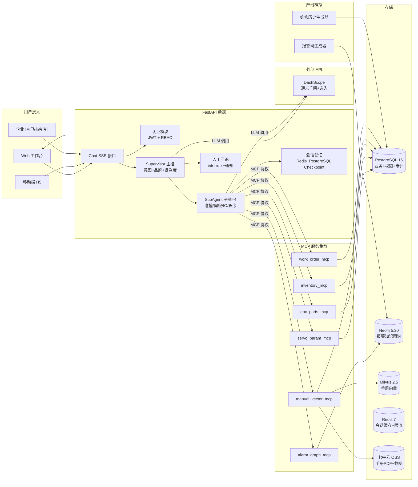
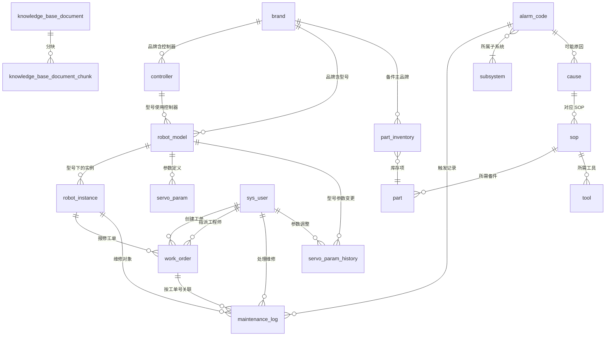
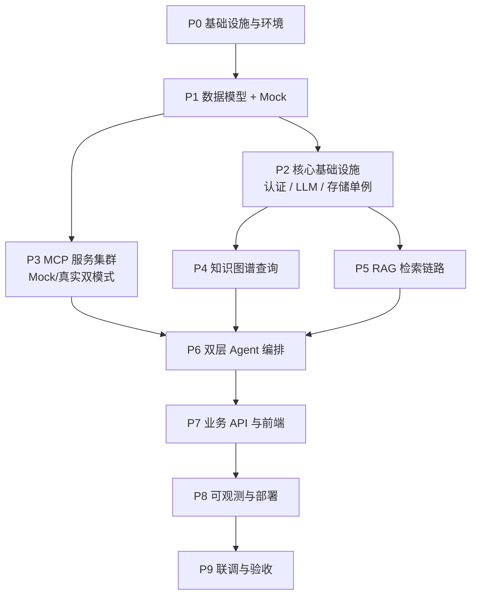

# RoboSuper Agent 工业机器人产线运维智能体平台

> 集成 LangGraph 双层 Agent 故障诊断、MCP 工具协议、RAG 机器人手册检索、Neo4j 知识图谱多跳查询的工业机器人运维 Demo
>
> 文档更新日期：2026-08-12
> 适用场景：学习练习 / 演示 / 简历项目 / 试点客户灰度

---

## 0. 项目定位

### 0.1 一句话描述

RoboSuper Agent 是一套面向汽车焊装/装配、3C 电子、新能源电池产线多品牌工业机器人（FANUC/ABB/KUKA/安川）运维场景的智能体平台，通过 LangGraph 双层 Agent 架构（Supervisor 宏观调度 + 4 个 SubAgent 微观执行）结合 MCP 工具协议解耦报警图谱、伺服参数、备件 EPC、手册向量等异构数据源，通过 RAG 检索机器人手册片段，通过 Neo4j 知识图谱多跳查询"报警-原因-SOP-备件"链路，用自然语言对话方式将复杂故障平均排障时长（MTTR）从 120 分钟压缩至 40 分钟以内。

### 0.2 核心能力

| 能力 | 实现方式 |
|------|---------|
| 自然语言排障对话 | React/Ant Design Pro 工作台 + FastAPI SSE 流式返回 |
| 双层 Agent 编排 | LangGraph Supervisor 主控 + 4 个 SubAgent 子图（碰撞/伺服/IO/程序），多意图 `Send` 并行分发 |
| MCP 工具协议 | FastMCP 6 个独立微服务（图谱/参数/备件/手册/库存/工单） |
| 工单管理 | work_order_mcp 维护「报警→诊断→工单→指派→处理→验收」运维闭环 |
| 报警知识图谱 | Neo4j 存储 4 大品牌 2000+ 报警码 + Cypher 多跳查询 |
| 机器人手册 RAG | Milvus 向量检索 + 自建 BM25（jieba + rank-bm25）+ RRF 融合 |
| LLM 调用 | DashScope 通义千问（qwen-max/plus/turbo 三档按节点复杂度切换）+ tenacity 重试 + Redis 缓存 |
| SOP 生成 | LLM 按知识图谱结构化数据组织语言，JSON Mode 强约束输出 |
| 人工回退 | LangGraph interrupt 机制 + 值班工程师通知 |
| 备件 EPC 匹配 | 图嵌入相似性 + 跨仓库库存查询 |
| 手册 PDF 存档 | 七牛云 OSS 签名 URL 按需下发 |
| 权限管理 | JWT + RBAC（admin / engineer / viewer） |
| 检查点持久化 | LangGraph Checkpointer，工作流可断点续跑 |

### 0.3 设计原则

1. **API 优先，不本地部署大模型**：当前无 GPU 服务器，统一通过 DashScope API 调用 LLM 与嵌入服务，零硬件投入；单供应商 + 三档模型 + 重试/缓存即可覆盖成本、质量与可用性
2. **双层 Agent 关注点分离**：Supervisor 只管意图识别与任务分发，SubAgent 专注一类故障的诊断流程，Prompt 与工具集独立避免上下文污染
3. **MCP 协议解耦工具与 Agent**：所有数据源访问封装为独立 MCP 微服务，工具自动注册，新增数据源无需改 Agent 代码
4. **图谱与向量互补**：报警-原因-SOP-备件走 Neo4j 结构化查询保证准确，手册片段走 Milvus 语义检索补充上下文
5. **Mock 与真实可切换**：所有 MCP 服务支持 `MCP_BACKEND_MODE` 环境变量切换 Mock/真实后端，开发期零外部依赖
6. **公开数据替代真实数据**：4 大品牌报警手册公开部分整理 + Wikipedia 机器人条目作为语料 + 合成 Mock 数据
7. **LLM 做组织不做编造**：SOP 必须基于知识图谱结构化数据生成，LLM 仅做语言组织；工具未返回数据时如实说"未查询到"
8. **成本可控**：API 调用按需触发，单次排障约 0.008 元，日均成本 < 50 元

---

## 1. 整体架构



### 四条核心数据流

1. **对话流（用户->Agent->工具->LLM）**：用户提问 -> Chat SSE 接口 -> Supervisor 意图分类（调 LLM） -> 品牌/紧急度判断 -> 多意图 `Send` 并行分发 SubAgent -> 调 MCP 工具查图谱/手册/参数 -> LLM 生成 SOP -> SSE 流式返回
2. **知识图谱查询流**：报警码 -> alarm_graph_mcp -> Neo4j Cypher 多跳查询（报警-原因-SOP-备件） -> 结构化结果返回 SubAgent
3. **手册 RAG 流**：用户描述 -> manual_vector_mcp -> DashScope 嵌入 API -> Milvus 向量召回 + 自建 BM25（jieba 分词 + rank-bm25 内存索引）召回 -> RRF 融合 Top-K -> 返回手册片段+页码
4. **工单管理流**：诊断结论 -> work_order_mcp 建工单 -> 指派工程师 -> 处理过程状态流转 -> 关联维修历史 -> 验收关单，全程记录于 PG

---

## 2. 技术选型

| 层 | 选型 | 说明 |
|---|---|---|
| 后端框架 | FastAPI 0.115 | 异步、自动 OpenAPI 文档、SSE/WS 原生 |
| 业务数据库 | PostgreSQL 16 | 业务数据 + 权限 + 审计日志 + 手册切片原文（BM25 在应用层内存索引） |
| 知识图谱 | Neo4j 5.20 | 报警-原因-SOP-备件图查询，Cypher 多跳 |
| 向量库 | Milvus 2.5 | 机器人手册向量检索，HNSW + cosine |
| 关键词检索 | 自建 BM25（jieba 分词 + rank-bm25 内存索引） | 纯 Python 跨平台，免 PG 扩展编译；BM25Okapi 排序 |
| 缓存 | Redis 7 | 会话缓存 + 限流 + 热点查询缓存 |
| LLM | 通义千问 Qwen-Max/Plus/Turbo | DashScope OpenAI 兼容 API，按节点复杂度切档；tenacity 重试 + Redis 缓存兜底 |
| Embedding | DashScope text-embedding-v4 | 1024 维，中英双语 |
| Agent 编排 | LangGraph 0.2 | 双层状态机，支持中断/回退/检查点 |
| Agent 框架 | LangChain 0.3 | 工具调用、Prompt 管理 |
| MCP 协议 | FastMCP 0.2 | MCP 服务端 + 客户端，自动工具注册 |
| 认证 | JWT (python-jose) + passlib[bcrypt] | 无状态鉴权 |
| ORM | SQLAlchemy 2.0 | Mapped 风格 |
| 数据校验 | Pydantic 2 | 请求/响应模型 |
| 前端 | React 18 + Ant Design Pro 5 + Vite 5 | 企业级中后台 |
| 实时图表 | ECharts | 报警趋势/看板图表 |
| 图谱可视化 | D3.js + react-force-graph | 报警关联树力导向布局 |
| 对象存储 | 七牛云 Kodo（S3 兼容） | 手册 PDF、报警截图 |
| 容器化 | Docker Compose | backend + frontend + 6 个 MCP |
| 环境管理 | conda + pip | `conda create -n robosuper python=3.11`，依赖固定于 `requirements.txt` |
| 可观测性 | Langfuse | Agent 链路追踪（会话级 trace 贯穿 Supervisor→子智能体→MCP 工具） |
| Mock 数据 | Faker 25 + Factory Boy | 中文合成数据生成 |

---

## 3. 模块设计

### 3.1 后端模块

```
backend/
├── app/
│   ├── main.py                  # FastAPI 入口 + lifespan + 路由注册
│   ├── config.py                # pydantic-settings 配置（.env 加载）
│   ├── core/                    # 基础设施
│   │   ├── database.py          # SQLAlchemy engine + SessionLocal
│   │   ├── milvus.py            # Milvus client 单例
│   │   ├── redis_client.py      # Redis 连接池
│   │   ├── oss_client.py        # 七牛云 OSS 封装（put_pdf + signed_url）
│   │   ├── llm_client.py        # DashScope LLM 客户端（单供应商 + 三档模型 + tenacity 重试）
│   │   ├── embed_client.py      # DashScope 嵌入 API 客户端
│   │   ├── mineru_client.py     # MinerU 在线文档解析（httpx 直接调用，无 SDK）
│   │   ├── security.py          # JWT 签发/校验 + bcrypt
│   │   ├── exception.py         # 自定义异常 + 全局 handler
│   │   └── deps.py              # 统一依赖注入
│   ├── models/                  # SQLAlchemy ORM 模型（12 张表）
│   ├── schemas/                  # Pydantic 请求/响应模型
│   ├── services/                # 业务逻辑层（每张表一个 service）
│   ├── api/v1/                   # REST 路由 + WebSocket + SSE
│   ├── supervisor/              # Supervisor 主控 Agent
│   │   ├── graph.py             # 主图定义
│   │   ├── state.py             # SupervisorState
│   │   ├── nodes/
│   │   │   ├── intent_classifier.py
│   │   │   ├── brand_detector.py
│   │   │   ├── urgency_evaluator.py
│   │   │   ├── dispatcher.py
│   │   │   ├── human_handoff.py
│   │   │   └── aggregator.py
│   │   └── prompts/
│   ├── workflows/               # 4 个 SubAgent 子图
│   │   ├── base.py
│   │   ├── state.py             # TroubleshootState
│   │   ├── collision_diag.py
│   │   ├── servo_loss_diag.py
│   │   ├── io_alarm_diag.py
│   │   └── program_issue_diag.py
│   ├── nodes/                   # 子图通用节点
│   │   ├── parse_alarm.py
│   │   ├── query_graph.py
│   │   ├── retrieve_manual.py
│   │   ├── check_params.py
│   │   ├── match_part.py
│   │   ├── generate_sop.py
│   │   ├── human_confirm.py
│   │   └── record_execution.py
│   ├── tools/                   # MCP 客户端
│   │   ├── mcp_client.py
│   │   └── tool_registry.py
│   ├── memory/                  # 会话记忆
│   │   ├── redis_cache.py
│   │   ├── checkpoint.py
│   │   └── context_window.py
│   ├── mock/                    # Mock 数据访问层
│   │   ├── seed_alarm_codes.py
│   │   ├── seed_maintenance_log.py
│   │   └── fixtures/
│   └── observability/
│       ├── tracing.py            # Langfuse 链路追踪
│       └── logging.py
├── mcp_servers/                 # 独立 MCP 微服务集群
│   ├── alarm_graph_mcp/
│   ├── servo_param_mcp/
│   ├── epc_parts_mcp/
│   ├── manual_vector_mcp/
│   ├── inventory_mcp/
│   ├── work_order_mcp/
│   ├── _mock/                   # 公共 Mock 资源
│   │   ├── fixtures/
│   │   ├── seed_scripts/
│   │   └── generators/
│   └── common/
└── tests/
```

### 3.2 模块职责

| 模块 | 主要职责 | 关键依赖 |
|------|---------|---------|
| core | 基础设施：DB/Neo4j/Milvus/Redis/OSS/LLM/Embed/MinerU/Security/DI | SQLAlchemy, neo4j, pymilvus, qiniu, openai, httpx, tenacity |
| api/v1 | REST 路由 + WebSocket + SSE 端点 | FastAPI |
| services | 业务逻辑（CRUD + 业务规则） | SQLAlchemy |
| supervisor | Supervisor 主控图：意图/品牌/紧急度/分发/回退 | langgraph, langchain |
| workflows | 4 个 SubAgent 子图：碰撞/伺服/IO/程序 | langgraph |
| nodes | 子图通用节点：解析/检索/生成 | mcp_client, llm_client |
| tools | MCP 客户端封装 + 工具自动索引 | mcp |
| memory | Redis 会话缓存 + LangGraph Checkpoint | redis, langgraph |
| mock | Mock 数据生成 + Fixture 加载 | faker |
| observability | Langfuse 链路追踪 | langfuse |

---

## 4. 双层 Agent 工作流方案

### 4.1 架构总览

```
用户提问
  ↓
Supervisor 主控图（LangGraph）
  ├─ intent_classifier    意图分类（LLM + Few-Shot）→ intents 列表
  ├─ brand_detector       品牌判别（LLM + 关键词）
  ├─ urgency_evaluator    紧急度评估（规则 + LLM）
  ├─ dispatcher           多意图 → Send fan-out 并行分发
  ├─ human_handoff        紧急度高时人工回退（interrupt）
  └─ aggregator           合并 N 个子图结果
  ↓
SubAgent 子图（×N 并行实例，单意图时 N=1）
  ├─ collision_diag        碰撞报警诊断
  ├─ servo_loss_diag      伺服失效诊断
  ├─ io_alarm_diag        IO 异常诊断
  └─ program_issue_diag   程序异常诊断
  ↓
通用节点流水线
  parse_alarm -> query_graph -> retrieve_manual -> check_params
       -> (match_part) -> generate_sop -> human_confirm -> record_execution
```

### 4.2 为何双层而非单层

| 维度 | 单层 ReAct Agent | 双层 Supervisor + SubAgent |
|------|------------------|---------------------------|
| 上下文管理 | 所有工具与 Prompt 在一个上下文，易污染 | Supervisor 与 SubAgent 各自独立上下文 |
| 可扩展 | 新增故障类型需改 Agent Prompt | 新增子图即可，不动 Supervisor |
| 可测试 | 端到端测试 | 子图可独立单测 |
| 资源效率 | 单一 LLM | 不同节点用不同 LLM tier（重要用 qwen-max，常规用 qwen-plus） |
| 人工接管 | 全局 interrupt | 紧急度高时 Supervisor 直接 interrupt，子图内部 SOP 含安全步骤也可 interrupt |

### 4.3 Supervisor 主控流程

```python
# app/supervisor/graph.py
from langgraph.graph import StateGraph, END
from langgraph.types import Send
from langgraph.checkpoint.postgres import PostgresSaver

def build_supervisor_graph():
    graph = StateGraph(SupervisorState)
    graph.add_node("intent_classifier", intent_classifier.run)
    graph.add_node("brand_detector", brand_detector.run)
    graph.add_node("urgency_evaluator", urgency_evaluator.run)
    graph.add_node("dispatcher", dispatcher.run)
    graph.add_node("human_handoff", human_handoff.run)
    graph.add_node("run_subagent", run_subagent.run)  # 每个意图一个并行子图实例
    graph.add_node("aggregator", aggregator.run)

    graph.set_entry_point("intent_classifier")
    graph.add_edge("intent_classifier", "brand_detector")
    graph.add_edge("brand_detector", "urgency_evaluator")
    graph.add_conditional_edges(
        "urgency_evaluator",
        lambda s: "human_handoff" if s["urgency"] >= 3 else "dispatcher",
    )
    # 多意图并行：dispatcher 把 intents 拆成 N 个 Send 分支，各自独立子图/检查点
    graph.add_conditional_edges(
        "dispatcher",
        lambda s: [Send("run_subagent", {"intent": i, "context": s["context"]})
                  for i in s["intents"]],
        path_map=["run_subagent"],
    )
    graph.add_edge("run_subagent", "aggregator")  # 聚合器等所有分支完成
    graph.add_edge("aggregator", END)
    graph.add_edge("human_handoff", END)

    # 复用业务 PG（langgraph 独立 schema），全环境一致，避免 SQLite/PG 行为漂移
    checkpointer = PostgresSaver.from_conn_string(settings.DATABASE_URL)
    checkpointer.setup()
    return graph.compile(checkpointer=checkpointer)
```

**多意图并行分发说明**：
- `state["intents"]` 是意图分类器输出的**列表**（如 `["collision_alarm", "io_anomaly"]`），单意图时列表长度 1，退化为串行
- LangGraph `Send` 是 fan-out 原语：每个意图创建一个独立的 `run_subagent` 分支，各自持有独立子图状态与检查点，可并发执行
- `aggregator` 在**全部分支完成**后合并结果（`results: list[dict]`），再统一组织回答
- 分支内仍可各自触发 `interrupt`（人工回退），不会阻塞其他分支

### 4.4 意图分类（LLM + Few-Shot，替代 LoRA 微调）

```python
# app/supervisor/nodes/intent_classifier.py
INTENT_PROMPT = """你是工业机器人运维意图分类器。
将用户消息分类为以下类别之一，可输出多个（用英文逗号分隔）：
- collision_alarm：碰撞报警（如 SRVO-050, 碰撞检测报警）
- servo_failure：伺服失效（如伺服驱动器故障、编码器异常）
- io_anomaly：IO 异常（如关节超限、IO 信号异常）
- program_issue：程序异常（如示教程序编译错误、运行中断）
- others：其他（参数咨询、SOP 查询等）

示例（5-shot）：
输入：FANUC SRVO-050 碰撞报警怎么处理
输出：collision_alarm
输入：R1 轴碰撞且伺服驱动器报错，怎么办
输出：collision_alarm,servo_failure
...

现在分类，只输出类别标签（多个用逗号分隔）：
用户消息：{query}
品牌（已知）：{brand}
报警码（如识别到）：{alarm_codes}
"""

async def run(state: SupervisorState) -> SupervisorState:
    chain = llm_client.get_chain()  # 默认 qwen-plus，tenacity 重试 3 次
    response = await chain.ainvoke(INTENT_PROMPT.format(**state))
    state["intents"] = [i.strip() for i in response.content.strip().split(",")]
    return state
```

### 4.5 SubAgent 子图（以碰撞诊断为例）

```python
# app/workflows/collision_diag.py
def build_collision_graph():
    graph = StateGraph(TroubleshootState)
    graph.add_node("parse_alarm", parse_alarm.run)
    graph.add_node("query_graph", query_graph.run)
    graph.add_node("retrieve_manual", retrieve_manual.run)
    graph.add_node("check_params", check_params.run)
    graph.add_node("match_part", match_part.run)
    graph.add_node("generate_sop", generate_sop.run)
    graph.add_node("human_confirm", human_confirm.run)
    graph.add_node("record_execution", record_execution.run)

    graph.set_entry_point("parse_alarm")
    graph.add_edge("parse_alarm", "query_graph")
    graph.add_edge("query_graph", "retrieve_manual")
    graph.add_edge("retrieve_manual", "check_params")
    graph.add_conditional_edges(
        "check_params",
        lambda s: "match_part" if s.get("need_replace_part") else "generate_sop",
    )
    graph.add_edge("match_part", "generate_sop")
    graph.add_edge("generate_sop", "human_confirm")
    graph.add_edge("human_confirm", "record_execution")
    graph.add_edge("record_execution", END)
    return graph
```

### 4.6 人工回退机制

LangGraph `interrupt` 暂停工作流，等待人工通过 API 提交输入后继续。

触发条件：
- 紧急度 ≥ 3（涉及安全/关键工位）
- SOP 含 `safety_check: true` 步骤
- 工具调用连续失败 3 次
- LLM 置信度 < 阈值（logprobs 评估）

```python
# app/supervisor/nodes/human_handoff.py
from langgraph.types import interrupt

async def run(state: SupervisorState) -> SupervisorState:
    await notify_human_operator(
        robot_id=state.get("robot_id"),
        alarm_code=state.get("alarm_code"),
        reason=f"urgency={state['urgency']}, needs human review",
    )
    human_input = interrupt({
        "prompt": "请人工确认处理方案",
        "context": state,
    })
    state["human_decision"] = human_input
    state["result"] = {"answer": human_input.get("resolution", "")}
    return state
```

### 4.7 检查点持久化

LangGraph Checkpointer（`langgraph-checkpoint-postgres`）自动保存工作流状态，复用业务 PostgreSQL 的 `langgraph` schema，开发与生产全环境一致：

```python
checkpointer = PostgresSaver.from_conn_string(settings.DATABASE_URL)
checkpointer.setup()  # 自动建 checkpoints 等表
```

任意节点失败后可从最近检查点恢复，避免重跑整个流程。配置 `thread_id` 实现会话级状态隔离。

**为何不另起 SQLite**：项目已有 PG，checkpoint 走 PG 零新增存储引擎，且避免"开发 SQLite / 生产 PG"两套实现的行为差异（并发、事务隔离均不同），与去除 ES 同理。

### 4.8 SSE 流式对话接口

```python
# app/api/v1/chat.py
@router.post("/chat")
async def chat(body: ChatRequest, user = Depends(get_current_user)):
    async def event_stream():
        config = {"configurable": {"thread_id": body.session_id}}
        async for event in supervisor.astream(
            {"user_query": body.query, "messages": messages},
            config=config,
            stream_mode="values",
        ):
            if "result" in event:
                yield f"data: {json.dumps({'type': 'answer', 'content': event['result']})}\n\n"
            if "tool_call" in event:
                yield f"data: {json.dumps({'type': 'tool', 'content': event['tool_call']})}\n\n"
        yield "data: [DONE]\n\n"

    return StreamingResponse(
        event_stream(),
        media_type="text/event-stream",
        headers={"Cache-Control": "no-cache", "X-Accel-Buffering": "no"},
    )
```

SSE 事件类型：`token`（LLM 文本片段）/ `tool_start` / `tool_end` / `answer` / `done` / `error`。

---

## 5. MCP 工具服务设计

### 5.1 MCP 协议简介

MCP（Model Context Protocol）是 Anthropic 提出的工具调用开放协议，将工具实现与 Agent 解耦：
- 工具独立部署为微服务（FastMCP）
- Agent 通过 MCP 客户端动态发现并调用工具
- 工具变更无需改 Agent 代码
- 未来可对接 Claude Desktop、Cursor 等外部 MCP 客户端

### 5.2 6 个 MCP 服务清单

| 服务 | 端口 | 后端存储 | 工具数 | Mock 后端 |
|------|------|---------|--------|-----------|
| `alarm_graph_mcp` | 9001 | Neo4j | 5 | JSON Fixture |
| `servo_param_mcp` | 9002 | PostgreSQL | 4 | JSON Fixture |
| `epc_parts_mcp` | 9003 | PostgreSQL | 6 | JSON Fixture |
| `manual_vector_mcp` | 9004 | Milvus + 自建 BM25 | 3 | JSON Fixture |
| `inventory_mcp` | 9006 | PostgreSQL | 3 | JSON Fixture |
| `work_order_mcp` | 9007 | PostgreSQL | 6 | JSON Fixture |

### 5.3 Mock/真实双模式切换

通过 `MCP_BACKEND_MODE` 环境变量决定后端实现，代码层无需改动：

```python
# mcp_servers/common/backend_switcher.py
def with_backend(real_impl, mock_impl):
    def decorator(func):
        @wraps(func)
        async def wrapper(*args, **kwargs):
            mode = os.getenv("MCP_BACKEND_MODE", "mock")
            impl = real_impl if mode == "real" else mock_impl
            return await impl(*args, **kwargs)
        return wrapper
    return decorator
```

启动方式：
```bash
# Mock 模式（开发期，零外部依赖）
MCP_BACKEND_MODE=mock python -m mcp_servers.alarm_graph_mcp.server

# 真实模式（接入 Neo4j/PG/Milvus）
MCP_BACKEND_MODE=real python -m mcp_servers.alarm_graph_mcp.server
```

### 5.4 MCP 服务端示例（报警图谱）

```python
# mcp_servers/alarm_graph_mcp/server.py
from fastmcp import FastMCP
from mcp_servers.common.backend_switcher import with_backend
from .backends.neo4j_backend import get_alarm_by_code as neo4j_impl
from .backends.mock_backend import get_alarm_by_code as mock_impl

mcp = FastMCP(name="alarm_graph_mcp", version="1.0.0")

@mcp.tool()
@with_backend(real_impl=neo4j_impl, mock_impl=mock_impl)
async def get_alarm_by_code(brand: str, code: str) -> dict:
    """按品牌+报警码查询完整信息（含子系统、原因、SOP、备件）

    Args:
        brand: 机器人品牌（FANUC/ABB/KUKA/YASKAWA）
        code: 报警码，如 SRVO-050
    Returns:
        {alarm_id, code, description, severity, subsystem, causes, sops, parts, tools}
    """
    ...

if __name__ == "__main__":
    mcp.run(transport="stdio")
```

### 5.5 MCP 客户端封装

```python
# app/tools/mcp_client.py
class MCPClient:
    def __init__(self):
        self._sessions: dict[str, ClientSession] = {}
        self._tool_index: dict[str, tuple[str, dict]] = {}

    async def connect(self, server_name: str, command: list[str]):
        params = StdioServerParameters(command=command[0], args=command[1:])
        session = await ClientSession.connect(params)
        await session.initialize()
        tools = await session.list_tools()
        for tool in tools:
            self._tool_index[tool.name] = (server_name, tool.inputSchema)
        self._sessions[server_name] = session

    async def call(self, server: str, tool: str, args: dict) -> dict:
        result = await self._sessions[server].call_tool(tool, args)
        return json.loads(result.content[0].text)

    async def call_by_name(self, tool: str, args: dict) -> dict:
        """通过工具名直接调用，自动路由到对应 server"""
        server, _ = self._tool_index[tool]
        return await self.call(server, tool, args)
```

### 5.6 工具调用稳定性

| 要点 | 策略 |
|------|------|
| 超时 | 单工具 30s，可配置 |
| 重试 | tenacity 指数退避，最多 3 次 |
| 幂等 | 工具实现需保证同参数同结果 |
| 限流 | Redis 令牌桶，按 server 维度 |
| 链路追踪 | Langfuse trace_id 透传（一条用户会话贯穿子智能体与工具调用） |
| 鉴权 | JWT 校验，MCP 服务间 mTLS（生产） |
| 版本管理 | 工具 Schema 变更走 SemVer，旧版本兼容期 3 个月 |

---

## 6. LLM Agent 与工具

### 6.1 Agent 角色定义

| 角色 | 触发方式 | 输入 | 输出 |
|------|---------|------|------|
| **Supervisor** | 用户提问 | 自然语言 | 意图列表+品牌+紧急度+多意图并行分发 |
| **SubAgent** | Supervisor 分发 | 报警码+上下文 | SOP 步骤+备件+工具 |
| **报告器** | 手动/定时 | 维修历史聚合 | MTTR 统计报告 |
| **NER** | parse_alarm 节点 | 用户文本 | 报警码列表 |

### 6.2 LLM 客户端（DashScope 单供应商 + 三档模型 + 重试）

```python
# app/core/llm_client.py
from tenacity import retry, stop_after_attempt, wait_exponential
from langchain_openai import ChatOpenAI
from app.core.redis_cache import redis_get, redis_set

class LLMClient:
    """DashScope 单供应商：按 tier 选档，tenacity 重试 + Redis 缓存兜底"""

    BASE_URL = "https://dashscope.aliyuncs.com/compatible-mode/v1"
    TIER_MODELS = {
        "default": "qwen-plus",   # 意图分类、品牌判别、NER
        "strong":   "qwen-max",    # SOP 生成、复杂推理
        "fast":     "qwen-turbo",  # 简单关键词提取、状态判断
    }

    def get_chain(self, tier: str = "default", temperature: float = 0.3) -> ChatOpenAI:
        return ChatOpenAI(
            model=self.TIER_MODELS[tier],
            base_url=self.BASE_URL,
            api_key=settings.DASHSCOPE_API_KEY,
            temperature=temperature,
            timeout=30,
            max_retries=3,  # langchain-openai 内置重试
        )

    @retry(stop=stop_after_attempt(3), wait=wait_exponential(min=1, max=8))
    async def invoke(self, prompt: str, tier: str = "default", cache_key: str = None):
        # 1. 命中缓存直接返回（意图分类等可重复查询）
        if cache_key:
            cached = await redis_get(cache_key)
            if cached:
                return cached
        # 2. 调 DashScope，tenacity 兜 API 抖动
        chain = self.get_chain(tier)
        resp = await chain.ainvoke(prompt)
        # 3. 回写缓存（TTL 1h）
        if cache_key:
            await redis_set(cache_key, resp.content, ttl=3600)
        return resp.content

llm_client = LLMClient()
```

模型分级使用：
- `default`（qwen-plus）：意图分类、品牌判别、NER
- `strong`（qwen-max）：SOP 生成、复杂推理
- `fast`（qwen-turbo）：简单关键词提取、状态判断

**为何不做多供应商 fallback**：
- 多供应商路由要维护 3 套 API key、3 套 base_url、3 套模型映射，调试与 Mock 复杂度 ×3
- DashScope SLA 已较高；真正的故障兜底应走「重试 + 缓存 + 人工回退」：API 抖动由 tenacity 处理，常用意图分类走 Redis 缓存，紧急情况触发 LangGraph interrupt 让人接管
- 单供应商 + 三档模型即可覆盖成本（qwen-turbo）/ 质量（qwen-max）/ 平衡（qwen-plus）三者的取舍

### 6.3 工具清单（按 MCP 服务组织）

| MCP 服务 | 工具名 | 功能 |
|----------|--------|------|
| alarm_graph_mcp | `get_alarm_by_code` | 按品牌+报警码查报警信息 |
| | `get_cause_chain` | 获取故障原因链路（多跳） |
| | `get_similar_alarms` | 相似报警（图嵌入） |
| | `get_sop_by_cause` | 按原因查 SOP |
| | `get_alarm_statistics` | 报警统计（按品牌/子系统） |
| servo_param_mcp | `query_params` | 按机器人型号查伺服参数 |
| | `compare_params` | 对比参数差异 |
| | `get_param_history` | 参数变更历史 |
| | `check_param_in_range` | 校验参数是否在范围 |
| epc_parts_mcp | `search_part` | 按关键词/图号搜备件 |
| | `check_inventory` | 多仓库库存查询 |
| | `find_alternative` | 替代件匹配（图嵌入） |
| | `get_part_detail` | 备件详情 |
| | `get_part_compatibility` | 备件兼容品牌 |
| | `reserve_part` | 预设备件 |
| manual_vector_mcp | `search_manual` | 混合检索（向量+BM25+RRF） |
| | `get_manual_chunk` | 按 chunk_id 取原文 |
| | `list_manuals` | 手册列表 |
| inventory_mcp | `check_stock` | 跨仓库库存 |
| | `transfer_part` | 跨库调拨 |
| | `get_warehouse_list` | 仓库列表 |
| work_order_mcp | `create_work_order` | 由诊断结论建工单（报警码+机器人+优先级） |
| | `assign_engineer` | 指派工程师 |
| | `update_work_order_status` | 状态流转（created→assigned→in_progress→resolved→closed） |
| | `list_work_orders` | 工单列表（按状态/优先级/工程师过滤） |
| | `get_work_order_detail` | 工单详情（含诊断上下文快照） |
| | `close_work_order` | 关单并关联维修历史记录 |

### 6.4 反幻觉约束

系统提示词严格约束 LLM 不得编造业务数据：
- 报警码、备件号、伺服参数、产线状态必须通过 MCP 工具查
- 工具未返回数据时如实说"未查询到该报警码，请确认品牌与代码"
- 引用手册片段必须用 `search_manual` 检索，标注来源文档与页码
- SOP 必须基于知识图谱结构化数据组织语言，不得编造步骤
- 不把前一轮工具结果当本轮事实，每轮重新查

允许直接回答的场景：通用机器人常识、品牌技术对比、对工具结果的解读归纳。

---

## 7. RAG 机器人手册知识库

### 7.1 文档来源（公开资料 + Mock）

| 类型 | 来源 | 用途 |
|------|------|------|
| FANUC R-30iB Plus 报警手册 | FANUC 官网 / 工程论坛公开 PDF | 主知识库（FANUC） |
| ABB IRC5 / OmniCore 手册 | ABB Library 公开 PDF | 主知识库（ABB） |
| KUKA KSS 文档 | KUKA XCustomer 公开部分 | 主知识库（KUKA） |
| YASKAWA DX200/YRC1000 手册 | YASKAWA 官网 | 主知识库（安川） |
| Wikipedia 机器人条目 | Wikipedia API 抓取 | 通用术语语料（Mock 兜底） |
| ROS Wiki 文档 | https://wiki.ros.org 爬取 | 通用机器人技术语料 |
| 工程论坛博客 | 机器人网、CSDN 工业自动化专栏 | 案例语料 |

### 7.2 文档处理流程

```
PDF/Word/HTML 上传 -> MinerU 在线 API 解析（转 Markdown，扫描件自动 OCR）
        -> 按章节+报警码锚点切分 -> 向量化 -> 入库
                                                           |
                                             检索时 <- metadata 过滤（brand）
```

**解析方式**：直接调用 MinerU 在线 API（`https://mineru.net/api/v4`，走现有 `httpx`，无额外 SDK），上传 PDF/DOCX/HTML 转 Markdown，扫描件/乱码 PDF 自动走 OCR，公式转 LaTeX、表格转 HTML；不依赖任何本地文档解析库，也无需自建 OCR 服务。调用流程封装在 `app/core/mineru_client.py`：① `POST /file-urls/batch` 获取预签名上传地址 → ② 上传文件 → ③ `POST /extract/task` 提交解析任务（`is_ocr`、`language` 等参数）→ ④ 轮询 `GET /extract/task/{task_id}`（tenacity 重试，按 `PENDING/PROCESSING/SUCCEEDED/FAILED` 流转）→ ⑤ 下载返回 Markdown。任务状态复用 `knowledge_base_document.processing_status` 入库，扫描件 OCR 用 Precision 模式，需 MinerU token（`MINERU_TOKEN` 环境变量）。

**切分策略**：按章节标题切分，单 chunk 500 字符 + 50 重叠，保留 `brand`、`robot_model`、`alarm_code`、`section`、`page` 等 metadata 用于精确过滤。

**入库管理**：`knowledge_base_document` 表记录文档元数据 + 处理状态（PENDING/PROCESSING/READY/FAILED），`knowledge_base_document_chunk` 表记录每个分块内容 + Milvus 向量 ID。

### 7.3 检索策略：向量 + 自建 BM25（jieba + rank-bm25）+ RRF 混合

```python
# mcp_servers/manual_vector_mcp/tools/search_manual.py
async def search_manual(query: str, brand: str = None, top_k: int = 5) -> dict:
    # 1. 向量召回（DashScope 嵌入 API + Milvus）
    query_vec = await embed_client.embed_one(query)
    vector_hits = await milvus_client.search(
        collection="manual_chunks",
        data=[query_vec],
        filter=f"brand == '{brand}'" if brand else None,
        limit=top_k * 3,
        output_fields=["chunk_id", "text", "brand", "section", "page"],
    )

    # 2. BM25 召回（自建内存索引：jieba 分词 + rank-bm25，启动时从 PG 加载构建）
    bm25_hits = bm25_index.search(query, brand=brand, top_k=top_k * 3)

    # 3. RRF 融合
    fused = rrf_merge(vector_hits, bm25_hits, k=60)
    return {"results": fused[:top_k]}

def rrf_merge(list_a, list_b, k=60):
    """Reciprocal Rank Fusion"""
    scores = {}
    for rank, item in enumerate(list_a):
        scores[item["chunk_id"]] = scores.get(item["chunk_id"], 0) + 1 / (k + rank + 1)
    for rank, item in enumerate(list_b):
        scores[item["chunk_id"]] = scores.get(item["chunk_id"], 0) + 1 / (k + rank + 1)
    return sorted(scores.items(), key=lambda x: -x[1])
```

**自建 BM25 索引**（`mcp_servers/manual_vector_mcp/core/bm25_index.py`）：

- 服务启动时从 PG 读 `manual_chunk`（chunk_id / text / brand），jieba `lcut` 分词构建 `BM25Okapi`（按 brand 分桶）
- 索引常驻进程内存：约 1 万 chunk 只占几十 MB，单查询毫秒级
- 新文档解析完成 → 增量 `add_documents` 或整索引重建（demo 量级几秒）
- 报警码 `SRVO-050` 等精确术语：jieba 将字母数字串保留为单个 token，精确匹配不受影响

```python
from jieba import lcut
from rank_bm25 import BM25Okapi

class ManualBm25Index:
    def __init__(self, fetch_chunks):   # fetch_chunks 从 PG 读 chunk_id/text/brand/...
        rows = list(fetch_chunks())
        self._by_id = {}
        self._corpus = {}
        for b in {r["brand"] for r in rows}:
            bucket = [r for r in rows if r["brand"] == b]
            self._corpus[b] = bucket
            self._by_id.update({r["chunk_id"]: r for r in bucket})
        self._models = {b: BM25Okapi([lcut(r["text"]) for r in docs])
                        for b, docs in self._corpus.items()}

    def search(self, query: str, brand: str = None, top_k: int = 20) -> list:
        tokens = lcut(query)
        scores = {}
        for b, model in self._models.items():
            if brand and b != brand:
                continue
            for rank, score in enumerate(model.get_scores(tokens)):
                cid = self._corpus[b][rank]["chunk_id"]
                scores[cid] = scores.get(cid, 0) + score
        top = sorted(scores.items(), key=lambda x: -x[1])[:top_k]
        return [{"chunk_id": cid, "score": s, **self._by_id[cid]} for cid, s in top]
```

返回结果含原文片段 + 来源文档名 + 页码 + 相似度分数，便于 LLM 引用标注。

**为何不用 Elasticsearch / PG FTS**：
- 自建 BM25 纯 Python（jieba + rank-bm25），跨平台免编译，避开 zhparser 需编译 `.so` 的运维成本（Windows / Docker 默认镜像不含）
- Mock 语料约 1 万 chunk（4 品牌 × Wikipedia 机器人条目），内存索引几十 MB、查询毫秒级，远低于 PG FTS 性能拐点
- `jieba` 中文分词质量足以处理机器人手册术语；报警码 `SRVO-050` 等精确术语由 token 精确匹配命中
- 真正需要 ES 的高级聚合/同义词词典再升级，Demo 阶段无收益

---

## 8. 产线数据模拟器（Mock）

> 由于当前无真实数据接入，报警码/维修历史/伺服参数/备件等演示数据由本地模拟器生成。

### 8.1 报警码 Mock 生成器

基于 4 大品牌报警码格式模板合成：

| 品牌 | 报警码格式 | 示例 |
|------|-----------|------|
| FANUC | `SRVO-XXX` | SRVO-023, SRVO-050, SRVO-062 |
| ABB | 数字 | 10046, 50050, 20054 |
| KUKA | `KSSXXXXX` | KSS00404, KSS00126 |
| 安川 | `ALARM XXXX` | ALARM 4401, ALARM 4407 |

```python
# mcp_servers/_mock/generators/alarm_code_generator.py
BRAND_ALARM_TEMPLATES = {
    "FANUC": {"prefix": "SRVO-", "common": [(23, "伺服放大器报警"), (50, "碰撞检测"), (62, "伺服过载")]},
    "ABB": {"prefix": "", "common": [(10046, "关节超限"), (50050, "编码器通信"), (20054, "驱动温度过高")]},
    "KUKA": {"prefix": "KSS", "common": [(404, "伺服驱动通信"), (126, "编程错误")]},
    "YASKAWA": {"prefix": "ALARM ", "common": [(4401, "超程报警"), (4407, "伺服过载")]},
}

CAUSE_POOL = {
    "伺服子系统": [("驱动器电源故障", 0.35), ("编码器通信线缆松动", 0.25), ...],
    "本体子系统": [("减速机扭矩超限", 0.40), ("机械碰撞", 0.30), ...],
    # ...
}

def generate_alarm_codes(count_per_brand: int = 500) -> list[dict]:
    """生成报警码 + 子系统 + 原因 + SOP + 备件完整结构。"""
    # 输出 ~2000 条到 alarm_codes.json
```

**输出**：`mcp_servers/_mock/fixtures/alarm_codes.json`（4 品牌 × 500 = 2000 条）

### 8.2 维修历史 Mock 生成器

```python
# mcp_servers/_mock/generators/maintenance_log_generator.py
ROBOT_MODELS = [
    ("FANUC", "R-2000iC/210L"), ("FANUC", "M-20iD/25"),
    ("ABB", "IRB 6700-200"), ("ABB", "IRB 2600-12"),
    ("KUKA", "KR 210 R2700"), ("KUKA", "KR 16-2"),
    ("YASKAWA", "MH50-35"), ("YASKAWA", "GP12"),
]

def generate_maintenance_logs(count: int = 5000) -> list[dict]:
    """生成 2 年内 5000 条维修历史，含报警码、原因、SOP、备件、时长、工程师。"""
    # Faker 中文生成工程师姓名，时间序列覆盖 2024-01 到 2026-08
```

**输出**：`mcp_servers/_mock/fixtures/maintenance_logs.json`（5000 条）

### 8.3 伺服参数与备件 EPC 生成器

- **伺服参数**：按 80 个机器人型号 × 20 个常用参数 = 1600 条，含 default/min/max/unit
- **备件 EPC**：按 4 大品牌 × 375 个常见备件 = 1500 条，含 part_no/name/price/lead_time/compatible_brands

### 8.5 Wikipedia 公开语料抓取

```python
# scripts/fetch_wikipedia_robots.py
import wikipediaapi

wiki = wikipediaapi.Wikipedia("robosuper-agent/1.0", "zh")
TOPICS = ["工业机器人", "FANUC", "ABB_机器人", "KUKA", "安川电机",
          "伺服电机", "可编程逻辑控制器", "运动控制"]

def fetch_and_chunk():
    """抓取 Wikipedia 条目，按 500 字符切分，输出 manual_chunks.json。"""
    # 输出 ~10000 chunks 作为 Mock 手册语料
```

### 8.6 一键生成与灌入

```bash
# scripts/bootstrap_mock_data.sh
#!/bin/bash
set -e

echo "[1/5] 生成报警码 Mock 数据..."
python -m mcp_servers._mock.generators.alarm_code_generator

echo "[2/5] 生成维修历史 Mock 数据..."
python -m mcp_servers._mock.generators.maintenance_log_generator

echo "[3/5] 生成伺服参数 Mock 数据..."
python -m mcp_servers._mock.generators.servo_param_generator

echo "[4/5] 生成备件 EPC Mock 数据..."
python -m mcp_servers._mock.generators.parts_generator

echo "[5/5] 抓取 Wikipedia 机器人条目作为手册语料..."
python scripts/fetch_wikipedia_robots.py

echo ""
echo "Mock 数据生成完成，存放于 mcp_servers/_mock/fixtures/"
echo ""
echo "接下来可选择："
echo "  A) 灌入真实存储（需先启动 Neo4j/PG/Milvus）："
echo "     python -m mcp_servers._mock.seed_scripts.seed_neo4j"
echo "     python -m mcp_servers._mock.seed_scripts.seed_postgres   # 业务表 + manual_chunk 的 tsv 自动生成"
echo "     python -m mcp_servers._mock.seed_scripts.seed_milvus"
echo ""
echo "  B) 直接以 Mock 模式启动服务（无需外部存储）："
echo "     MCP_BACKEND_MODE=mock docker compose up"
```

---

## 9. 数据库设计

### 9.1 实体关系图



> 注：上半部分为 PostgreSQL 业务表（12 张，实线对应 init.sql 真实外键），下半部分为 Neo4j 知识图谱节点（Brand/Controller/RobotModel/AlarmCode/Cause/SOP/Part/Tool 等）。PG 通过 `alarm_code` / `part_no` 字符串与 Neo4j 跨存储关联，不建外键。

### 9.2 表清单

**PostgreSQL（业务表，12 张）**

**认证模块（1 张）**
- `sys_user` - 系统用户（admin/engineer/viewer）

**业务模块（7 张）**
- `brand` - 机器人品牌
- `controller` - 控制器型号
- `robot_model` - 机器人型号
- `robot_instance` - 机器人实例（客户资产）
- `part_inventory` - 备件库存（按仓库）
- `servo_param` - 伺服参数定义
- `work_order` - 排障工单（no 唯一编号、报警码、优先级、状态流转、指派工程师）

**运维模块（2 张）**
- `maintenance_log` - 维修历史
- `servo_param_history` - 参数变更历史

**RAG 模块（2 张）**
- `knowledge_base_document` - 知识库文档元数据（标题、分类、处理状态、分块数）
- `knowledge_base_document_chunk` - 文档分块（内容 + Milvus 向量 ID + 页码）

> 上述 PG 表合计 12 张（含 sys_user）。`work_order` 与 `maintenance_log` 通过工单号关联：工单记录处理过程状态流转，维修历史记录最终处理结果。

**Neo4j（图谱节点 12 类）**
- `Brand`, `Controller`, `RobotModel`, `Subsystem`, `Component`
- `AlarmCode`, `Cause`, `SOP`, `Tool`, `Part`, `Symptom`, `RobotInstance`

**Neo4j（关系 11 类）**
- `HAS_BRAND`, `USES_CONTROLLER`, `RAISES_ALARM`, `LOCATED_IN`
- `CAUSED_BY`, `SOLVED_BY`, `REQUIRES_PART`, `REQUIRES_TOOL`
- `HAS_SYMPTOM`, `SIMILAR_TO`, `INSTALLED_AT`

### 9.3 关键设计决策

| 决策 | 理由 |
|------|------|
| 报警码、原因、SOP 走 Neo4j 而非 PG | 多跳查询天然图结构，Cypher 表达力强 |
| 备件 EPC 走 PG 而非 Neo4j | 备件检索是结构化查询，PG 索引高效 |
| `maintenance_log.parts_used` 用 JSONB | 不同维修使用的备件不同，JSONB 灵活扩展 |
| `robot_instance.asset_no` 唯一约束 | 客户资产编号是稳定标识 |
| 手册切片走 Milvus 向量 + 自建 BM25 双路 | 向量召回语义相似，jieba + rank-bm25 召回精确关键词，RRF 融合互补；纯 Python 免 PG 扩展编译 |
| `knowledge_base_document_chunk.milvus_id` 而非存向量 | 向量在 Milvus，PG 只存 ID 与 metadata，避免冗余 |
| LangGraph Checkpoint 复用业务 PostgreSQL（`langgraph` schema） | PG 已在栈内零额外存储；全环境一致，避免 SQLite/PG 行为漂移 |
| 容器设 `TZ=Asia/Shanghai` | 确保告警时间与本地时间一致 |
| Mock 数据与真实数据双模式 | 通过环境变量切换，开发期零外部依赖 |
| LLM API key 通过 .env 注入 | 避免硬编码，支持多环境配置 |
| `alert_record.created_at` 显式设为 `datetime.now()` | 避免 Postgres 服务器时区与容器时区不一致导致时间偏差 |

---

## 10. 认证与权限

### 10.1 认证流程

```
登录页 -> POST /api/v1/auth/login {username, password}
  -> bcrypt 校验密码
  -> 生成 JWT（含 user_id, username, role, exp，默认 24h）
  -> 返回 {access_token, token_type, user}

后续请求 -> Header: Authorization: Bearer <token>
  -> 中间件解析 JWT
  -> 注入 current_user
  -> Depends(get_current_user) 拿当前用户
```

### 10.2 角色权限（RBAC）

| 角色 | 权限范围 |
|------|---------|
| `admin` | 全部：用户管理、机器人型号管理、知识库管理、模型配置、报告 |
| `engineer` | 排障对话、报警查询、备件查询、检测启动、SOP 确认、报告查看 |
| `viewer` | 只读：看板、报警列表、报告查看、对话（只读模式） |

### 10.3 WebSocket / SSE 鉴权

- WebSocket：`ws://host/ws/alarms?token=<jwt>`，从 query 解析 token，校验失败用 close code 4401 关闭连接
- SSE：`/api/v1/agent/chat` 请求头携带 `Authorization: Bearer <token>`

---

## 11. API 设计

### 11.1 REST 路由清单

| 模块 | 路径前缀 | 主要端点 |
|------|---------|---------|
| 认证 | `/api/v1/auth` | login / logout / me / password |
| 用户管理 | `/api/v1/users` | CRUD（admin 专属） |
| 机器人型号 | `/api/v1/robot-models` | CRUD |
| 机器人实例 | `/api/v1/robots` | CRUD + 维修历史 |
| 报警码查询 | `/api/v1/alarms` | list / detail / by-brand / statistics |
| 备件查询 | `/api/v1/parts` | search / detail / inventory / alternatives |
| 伺服参数 | `/api/v1/servo-params` | query / compare / history |
| 维修历史 | `/api/v1/maintenance` | list / detail / create |
| 工单管理 | `/api/v1/work-orders` | list / detail / create / assign / status / close |
| 知识库 | `/api/v1/knowledge` | upload / documents / chunks / test-retrieval |
| Agent | `/api/v1/agent` | /chat (SSE) / tools / sessions |
| 管理 | `/api/v1/admin` | mock-data / model-config / mcp-status |

### 11.2 SSE 端点

| 路径 | 用途 | 推送内容 |
|------|------|---------|
| `/api/v1/agent/chat` | Agent 对话流 | `token` / `tool_start` / `tool_end` / `answer` / `done` / `error` |

### 11.3 WebSocket 端点

| 路径 | 用途 | 推送内容 |
|------|------|---------|
| `/ws/alarms?token=xxx` | 报警推送 | 报警事件 + 人工回退请求 |

---

## 12. 前端页面

### 12.1 路由与页面

| 路由 | 页面 | 说明 | 权限 |
|------|------|------|------|
| `/login` | 登录页 | 账号密码登录 | 公开 |
| `/dashboard` | 总览大屏 | 报警统计、MTTR | 已登录 |
| `/workspace` | 工程师工作台 | 对话面板 + 报警关联树 + SOP 导航 | engineer+ |
| `/alarm/list` | 报警中心 | 列表 + 详情 + 处理 | 已登录 |
| `/alarm/graph` | 报警关联树 | D3 力导向图可视化 | 已登录 |
| `/robot/list` | 机器人列表 | 实例管理 | 已登录 |
| `/robot/model` | 机器人型号 | 型号管理 | admin 写 |
| `/part/search` | 备件查询 | 搜索 + 替代件 | 已登录 |
| `/part/inventory` | 库存管理 | 跨仓库库存 | 已登录 |
| `/servo-param` | 伺服参数 | 查询与对比 | 已登录 |
| `/maintenance/log` | 维修历史 | 列表 + 详情 | 已登录 |
| `/work-order` | 工单管理 | 列表 + 详情 + 状态流转 + 指派 | engineer+ |
| `/knowledge/document` | 知识库文档 | 上传 + 管理 | admin 写 |
| `/knowledge/chunk` | 知识库分块 | 查看 + 编辑 | admin 写 |
| `/knowledge/retrieval` | 检索测试 | RAG 检索调试 | 已登录 |
| `/user` | 用户管理 | 用户 CRUD | admin |
| `/profile` | 个人中心 | 修改密码 | 已登录 |

### 12.2 工作台布局

工程师工作台采用三栏布局：
- **左栏**：对话面板（SSE 流式输出 + 工具调用指示器）
- **中栏**：报警关联树（D3 力导向图，节点详情侧滑）；`/ws/alarms` 收到新告警时**命中节点脉冲高亮 + 关联链路上色**（模拟实时拓扑流，成本远低于真·流式拓扑）
- **右栏**：SOP 步骤导航（含安全确认按钮）+ 备件详情卡片

### 12.3 前端技术栈

| 库 | 用途 |
|----|------|
| React 18 + TypeScript | 框架 |
| React Router 6 | 路由 + 守卫 |
| Zustand / TanStack Query | 状态管理 + 服务端状态 |
| Ant Design Pro 5 | UI 组件 |
| ECharts | 节拍趋势图 |
| D3.js + react-force-graph | 报警关联树 |
| Axios | HTTP 请求（带 JWT 拦截器） |
| EventSource API | SSE 流式接收 |
| markdown-it | 渲染 LLM 回答（Markdown） |

### 12.4 关键组合式 Hook

| Hook | 用途 |
|------|------|
| `useCrud` | 通用列表 CRUD（分页、查询、增删改） |
| `usePermission` | 角色权限判断 |
| `useAlertWs` | 告警 WS 单例连接 + 自动重连 |
| `useChatSse` | Agent 对话 SSE 流式接收 |
| `useAlarmGraph` | 报警关联树 D3 渲染 + 订阅 `/ws/alarms` 对命中节点做脉冲高亮与链路染色 |

---

## 13. 部署架构

### 13.1 服务部署

| 服务 | 部署方式 | 端口 |
|------|---------|------|
| FastAPI 后端 | Docker 容器 | 8000 |
| React 前端（nginx） | Docker 容器 | 80 |
| PostgreSQL | 宿主机或独立容器 | 5432 |
| Neo4j | 宿主机或独立容器 | 7687 / 7474 |
| Milvus | 宿主机或独立容器 | 19530 |
| Redis | 宿主机或独立容器 | 6379 |
| MCP 服务集群（7 个） | Docker 容器 | 9001-9007 |
| Langfuse | Docker 容器 | 3000 |

### 13.2 Docker Compose 配置

`docker-compose.yml` 容器化 backend + frontend + 7 个 MCP 服务，数据存储在宿主机或独立容器：
- backend 容器配置 `extra_hosts` 让 MCP 服务可解析
- 所有容器设 `TZ=Asia/Shanghai`，避免时间偏差
- Mock Fixture 通过 volume 挂载（`./mcp_servers/_mock:/app/_mock`）
- 知识库上传文件通过 named volume 持久化（`backend_uploads`）
- LangGraph 检查点存于 PG（`langgraph` schema），无需额外 volume

### 13.3 nginx 反代

前端 nginx 同时承担：
- 静态文件服务（dist 目录）
- API 反代（`/api/` -> `backend:8000`）
- SSE 反代（`/api/v1/agent/chat`，需 `proxy_buffering off` 关闭缓冲）
- WebSocket 反代（`/ws/`，需 `map $http_upgrade $connection_upgrade` 处理 Connection header）

### 13.4 更新部署

```bash
git pull
docker compose up -d --build backend frontend mcp-alarm-graph mcp-servo-param mcp-epc-parts mcp-manual-vector mcp-inventory mcp-work-order
```

`--build` 标志必须加，否则 Docker 复用旧镜像，新代码不生效。

---

## 14. 关键风险与对策

| 风险 | 对策 |
|------|------|
| LLM API 性能不达标 | 流式输出 + Prompt 缓存 + 按节点复杂度切档（qwen-turbo 加速简单节点） |
| LLM API 成本失控 | 模型分级（turbo/plus/max）、token 监控告警 |
| LLM API 网络依赖 | tenacity 重试 3 次 + Redis 缓存常用意图 + 紧急度高时 LangGraph interrupt 人工兜底 |
| 数据隐私（API 上送） | 调用前脱敏处理（去 asset_no、客户名等 PII） |
| MCP 工具调用失败 | 幂等设计 + 重试 + 降级到 LLM 直答 |
| Mock 数据与真实差异 | 上线前真实数据回归测试，保留 Mock 作为降级方案 |
| 跨品牌知识断层 | 优先 FANUC，其他品牌按需扩展 |
| 模型幻觉 | SOP 基于图谱结构化数据生成，JSON Mode 强约束 |
| 七牛云服务中断 | 关键文件本地缓存 + 切换其他 OSS（S3 兼容） |
| 知识图谱多跳查询慢 | 索引优化 + 缓存热点 + 深度限制 ≤ 3 跳 |
| 默认 admin 密码被爆破 | 首次登录强制改密 |
| 告警时间偏差 8 小时 | 容器 TZ=Asia/Shanghai + 显式 `created_at=datetime.now()` |
| MCP 服务注册中心单点 | 生产用 Consul 集群，开发期本地 YAML 配置 |

---

## 15. 后续扩展方向

| 方向 | 简述 | 价值 |
|------|------|------|
| 本地 LoRA 部署 | 客户私有化时切换 Qwen3-32B + LoRA | 数据不出域 |
| 多模态 RAG | 报警截图向量化入库 | 复盘检索（"找类似事故画面"） |
| LLM 多模态 | 接 qwen-vl-max 让 Agent 看故障图片 | 文本无法描述时降级 |
| 预测性维护 | LSTM/Prophet 替代 LLM 做时序预测 | PHM 能力 |
| 数字孪生 | Three.js 产线 3D 模型 + 实时数据 | 大屏升级 |
| 多租户 | 客户产线隔离 | SaaS 化 |
| 知识图谱自动扩展 | LLM 从维修历史抽取新 Cause/SOP 关系 | 自学习 |
| 语音对话 | ASR + TTS 接入 | 现场工程师解放双手 |
| 备件撮合交易 | 接入供应商库存系统 | 商业模式扩展 |
| 移动端 App | React Native 现场工程师 App | 现场使用 |
| 边缘部署 | MCP 服务跑在产线边缘节点 | 降低延迟 |

---

## 16. 开发规划（从基础设施到功能，分阶段推进）

> 目标：在单台开发机 + 演示机环境下，按「基础设施 -> 数据 -> 能力 -> 业务 -> 交付」顺序推进，每阶段结束都有一个可运行、可验收的增量交付，避免最后一刻联调爆雷。

### 16.1 总体节奏

| 阶段 | 主题 | 预计工期 | 核心交付物 | 里程碑演示点 |
|------|------|---------|-----------|-------------|
| P0 | 基础设施与环境搭建 | 2 天 | 可启动的空项目 | 健康检查接口 + 全部外部存储容器健康 |
| P1 | 数据模型与 Mock 数据 | 4 天 | 建表 + 生成器 + 种子数据 | 三库（PG/Neo4j/Milvus）有数可查 |
| P2 | 核心基础设施模块 | 3 天 | core 层全量 + JWT 认证 | 登录接口 + DashScope 客户端可用 |
| P3 | MCP 服务集群 | 5 天 | 7 个 MCP + 双模式 | 后端可调通全部 MCP 工具 |
| P4 | 知识图谱查询 | 3 天 | Cypher 工具集 | 报警码 4 跳查询 <200ms |
| P5 | RAG 检索链路 | 3 天 | 手册库 + 混合检索 | `search_manual` 返回 Top-K 带页码 |
| P6 | 双层 Agent 编排 | 5 天 | Supervisor + 4 子图 + SSE | 一句话排障全流程跑通 |
| P7 | 业务 API 与前端 | 6 天 | REST API + 前端页面 | 工作台对话 + 实时看板 |
| P8 | 可观测与部署 | 3 天 | 监控 + 一键部署 | docker compose 全栈起 |
| P9 | 联调与验收 | 2 天 | E2E 用例 + Demo 脚本 | 验收清单全绿 |

合计约 **36 人日**（单人全职约 7 周）。

### 16.2 阶段依赖关系



- **主线串行**：P0 → P1 → P2/P3 → P6 → P7 → P8 → P9，每步前置完成才进入下一步
- **可并行支线**：P1 完成后，P2 与 P3 可双人并行；P7 的前端脚手架可提前到 P6 中期启动（只依赖 P2 的登录与数据结构，不依赖 Agent）
- **原则**：任一阶段回退时只回退到该阶段入口，不推翻已验收的上游交付

### 16.3 P0 基础设施与环境搭建（第 1-2 天）

**目标**：可运行的开发环境，所有外部依赖以 Docker 就绪，空项目可启动。

**任务清单**
1. conda 环境：`conda create -n robosuper python=3.11 -y` + `conda activate robosuper` + `pip install -r requirements.txt`（FastAPI / SQLAlchemy / pydantic-settings / neo4j / pymilvus / redis / langchain / langgraph / langgraph-checkpoint-postgres / openai / fastmcp / qiniu / tenacity）；依赖变更后 `conda env export > environment.yml` 留存环境快照
2. `docker-compose.yml` 起 PostgreSQL 16 / Neo4j 5.20 / Milvus 2.5 / Redis 7，全部带 healthcheck
3. `.env.example` + `app/config.py`（pydantic-settings 加载，含 `DASHSCOPE_API_KEY`）
4. FastAPI 骨架：`main.py` + `/healthz` + 全局异常 handler + 日志配置
5. 目录骨架：按 3.1 结构建 `app/`、`mcp_servers/`、`tests/`
6. 提交规范：ruff + black + mypy 接入 pre-commit

**验收标准**
- [ ] `docker compose ps` 全部 healthy
- [ ] `uvicorn app.main:app --reload` 启动，`GET /healthz` 返回 ok
- [ ] 复制 `.env.example` 为 `.env` 即可运行，无硬编码

### 16.4 P1 数据模型与 Mock 数据（第 3-6 天）

**目标**：12 张 PG 表 + 12 类 Neo4j 节点落地，Mock 生成器产出全部种子数据。

**任务清单**
1. SQLAlchemy ORM：sys_user / brand / controller / robot_model / robot_instance / part_inventory / servo_param / maintenance_log / servo_param_history / knowledge_base_document / knowledge_base_document_chunk
2. Alembic 迁移脚本（含 `manual_chunk.tsv` 生成列）
3. Neo4j 初始化：12 类节点 + 11 类关系 + 唯一约束 + 索引
4. Mock 生成器：`alarm_code_generator` / `maintenance_log_generator` / `servo_param_generator` / `parts_generator`
5. `scripts/fetch_wikipedia_robots.py` 抓取公开语料（约 1 万 chunk）
6. 种子脚本：`seed_neo4j.py` / `seed_postgres.py` / `seed_milvus.py`

**验收标准**
- [ ] `alembic upgrade head` 无报错，12 张表就绪
- [ ] PG 中报警码 / 备件 / 维修历史 / 伺服参数有数可查
- [ ] Neo4j 中 `MATCH (a:AlarmCode {code:'SRVO-050'})-[:CAUSED_BY]->()<-[:SOLVED_BY]->(s:SOP)` 能返回
- [ ] Milvus collection `manual_chunks` 有约 1 万条向量

### 16.5 P2 核心基础设施模块（第 7-9 天）

**目标**：core 层全部单例 + DashScope LLM/Embed 客户端 + JWT 认证（RBAC）。

**任务清单**
1. `database.py` / `neo4j.py` / `milvus.py` / `redis_client.py` / `oss_client.py`（七牛云 S3 兼容封装）
2. `llm_client.py`：单供应商 DashScope + 三档模型（qwen-max/plus/turbo）+ tenacity 重试 + Redis 缓存
3. `embed_client.py`：text-embedding-v4
4. `security.py` + `/api/v1/auth`（login / me / password）+ `deps.py`
5. `tests/` 冒烟测试（每个 client 一条 happy path）

**验收标准**
- [ ] 登录签发 JWT，携带 token 访问 `/api/v1/users` 返回 200，无 token 返回 401
- [ ] `llm_client.invoke("你好")` 返回内容；断网时重试 3 次后抛可感知异常
- [ ] 七牛云上传返回 signed_url（无 key 时 Mock 模式跳过）

### 16.6 P3 MCP 服务集群（第 10-14 天）

**目标**：6 个 MCP 微服务 + Mock/真实双模式，后端 MCP 客户端打通全部工具。

**任务清单**
1. `mcp_servers/common/backend_switcher.py` + 共享配置
2. 按依赖顺序逐个开发：`alarm_graph_mcp` → `servo_param_mcp` → `epc_parts_mcp` → `manual_vector_mcp` → `inventory_mcp` → `work_order_mcp`
   - 每个 MCP = FastMCP server + real backend（连真实存储）+ mock backend（读 JSON fixture）
   - Mock fixture 从 P1 种子数据导出
3. 后端 `tools/mcp_client.py` + `tool_registry.py`，启动时连 6 个 server 并建立工具索引
4. `scripts/smoke_mcp.py`：调通全部 6 服务 × 工具

**验收标准**
- [ ] `MCP_BACKEND_MODE=mock` 下 6 服务全绿；`=real` 下返回真实存储数据
- [ ] 后端 `call_by_name("get_alarm_by_code", ...)` 自动路由到正确 server

### 16.7 P4 知识图谱查询（第 15-17 天）

**目标**：图谱工具完善，「报警-原因-SOP-备件」4 跳查询可用。

**任务清单**
1. Cypher 工具：get_alarm_by_code / get_cause_chain / get_similar_alarms（图嵌入）/ get_sop_by_cause / get_alarm_statistics
2. 索引优化 + 热点查询 Redis 缓存
3. `/api/v1/alarms` REST 透出图谱数据
4. 单测：每个 Cypher 一条回归用例

**验收标准**
- [ ] `get_cause_chain("FANUC", "SRVO-050")` 返回原因链 + SOP + 备件，≤3 跳，<200ms
- [ ] 报警详情页能拉到图谱数据

### 16.8 P5 RAG 检索链路（第 18-20 天）

**目标**：手册切分入库 + Milvus 向量 + 自建 BM25（jieba + rank-bm25）+ RRF 融合。

**任务清单**
1. 文档处理管线：MinerU 在线 API 解析（PDF/DOCX/HTML → Markdown，含 OCR）→ 按章节切分 500 字 + 50 重叠 → 保留 brand/robot_model/alarm_code/section/page metadata
2. `manual_chunk` 表 + 自建 BM25 索引模块（jieba 分词 + BM25Okapi，启动从 PG 加载构建）
3. Embedding 批量入库 Milvus
4. `search_manual` 实现向量 + 自建 BM25 + RRF 融合
5. `/knowledge/retrieval` 检索测试（先出 API，前端 P7 接入）

**验收标准**
- [ ] `search_manual("伺服过载怎么处理", brand="FANUC")` 返回 Top-K 含页码
- [ ] 精确术语 `SRVO-050` 通过 BM25 精确 token 命中
- [ ] 准备 10 条评测 query，RRF 命中率较单路向量提升

### 16.9 P6 双层 Agent 编排（第 21-25 天）

**目标**：Supervisor + 4 SubAgent + 检查点 + interrupt + SSE 对话全流程。

**任务清单**
1. LangGraph + Checkpointer（`langgraph-checkpoint-postgres`，复用业务 PG，全环境一致）
2. Supervisor 图：intent_classifier / brand_detector / urgency_evaluator / dispatcher / human_handoff / aggregator，dispatcher 用 `Send` 做多意图并行 fan-out
3. 4 个子图：collision_diag / servo_loss_diag / io_alarm_diag / program_issue_diag
4. 通用节点：parse_alarm / query_graph / retrieve_manual / check_params / match_part / generate_sop / human_confirm / record_execution
5. Prompts + 反幻觉约束 + JSON Mode
6. SSE 接口 `/api/v1/agent/chat` + 事件流（token/tool/answer/done/error）

**验收标准**
- [ ] 提问「FANUC SRVO-050 怎么处理」全流程：意图 → 查图 → 手册 → 生成 SOP → SSE 返回
- [ ] 一次提问含多个报警时，N 个子图并行跑通并在聚合器合并输出
- [ ] 紧急度高触发 interrupt，`/chat` 返回人工确认事件，确认后可恢复继续
- [ ] 工具未命中时如实返回「未查询到」

### 16.10 P7 业务 API 与前端（第 26-31 天）

**目标**：全部 REST API + React 前端页面，可对外演示。

**任务清单**
1. API：/alarms /parts /servo-params /maintenance /work-orders /line /reports /knowledge /admin
2. 前端脚手架：Vite + React 18 + TS + Ant Design Pro 5 + React Router + Zustand / TanStack Query
3. 页面：登录 / 总览大屏 / 工程师工作台（三栏）/ 报警中心 / 报警关联树（D3，告警命中节点高亮）/ 机器人 / 备件 / 伺服参数 / 维修历史 / 工单管理 / 报告 / 知识库 / 用户管理
4. WS：`/ws/alarms`

**验收标准**
- [ ] 工作台三栏可用：左对话（SSE）、中图谱树、右 SOP 导航
- [ ] 大屏报警统计有数据
- [ ] 知识库上传 → 解析 → 检索测试闭环

### 16.11 P8 可观测与部署（第 32-34 天）

**目标**：监控链路 + 一键部署。

**任务清单**
1. Langfuse 链路追踪接入：backend/LLM/工具调用上报，Agent 编排全链路可见
2. docker-compose 全栈：backend + frontend(nginx) + 7 MCP + 存储
3. nginx 反代（SSE 需 `proxy_buffering off`，WS 需 Connection 头升级）
4. 生产 .env + 上传文件 named volume 持久化（检查点走 PG 无需 volume）

**验收标准**
- [ ] `docker compose up -d --build` 一条命令起全栈
- [ ] Langfuse 看到一条用户会话的完整 Agent 调用链（Supervisor → 子智能体 → MCP 工具）

### 16.12 P9 联调与验收（第 35-36 天）

**目标**：端到端 + Demo 脚本 + 文档收尾。

**任务清单**
1. E2E：登录 → 排障对话 → 图谱查询 → 手册引用 → 备件 → 报告生成
2. 10 条验收 query 回归（沿用 P5 评测集）
3. Demo 剧本（固定演示路径 + 备用降级场景）
4. README + 部署文档 + 演示视频录制

**验收标准**
- [ ] 验收清单全绿
- [ ] Demo 10 分钟讲完核心链路（Agent 排障 + 图谱 + RAG + 看板）

### 16.13 进度看板建议

每阶段开工前建对应的 `tasks/` 目录或 Kanban 列（TODO / InProgress / Review / Done）：
- **阶段卡片**：阶段名 + 验收标准链接
- **任务卡片**：单任务 ≤ 1 天，拆到可提交粒度
- **每日站会**：阻塞项 + 当天验收点，避免跨阶段污染
- **阶段出口**：本阶段验收标准全部打勾才算 Done，再进入下一阶段

---

## 附录：项目亮点

- **双层 Agent 架构**：Supervisor 主控 + 4 个 SubAgent 子图，关注点分离，可独立测试与扩展
- **MCP 协议解耦**：7 个独立 MCP 微服务，工具自动注册，未来可对接 Claude Desktop / Cursor
- **知识图谱多跳查询**：Neo4j Cypher 实现"报警码 -> 原因 -> SOP -> 备件"4 跳查询，准确率优于纯向量检索
- **混合检索 RAG**：向量（Milvus）+ 自建 BM25（jieba + rank-bm25 内存索引）+ RRF 融合，纯 Python 免 PG 扩展，召回准确率较单一方式提升 15-20%
- **LLM 单供应商 + 三档模型**：DashScope Qwen-Max/Plus/Turbo 按节点复杂度切档，tenacity 重试 + Redis 缓存 + LangGraph interrupt 人工兜底，避免多供应商路由的搭建成本
- **Mock/真实双模式**：`MCP_BACKEND_MODE` 环境变量切换，开发期零外部依赖，上线时无缝切换
- **公开数据替代**：4 大品牌报警手册公开部分 + Wikipedia 机器人条目 + 合成 Mock，无需真实客户数据即可启动
- **反幻觉约束**：系统提示词严格约束 + JSON Mode 强约束 + 工具未返回如实说"未查询到"
- **人工回退机制**：LangGraph interrupt 暂停工作流 + 值班工程师通知，紧急度高时自动触发
- **检查点持久化**：任意节点失败可从最近检查点恢复，避免重跑全流程
- **成本可控**：API 调用按需触发，单次排障约 0.008 元，日均成本 < 50 元
- **时区一致性**：容器 TZ + 显式 `created_at`，确保告警时间与本地时间一致

---

*文档结束*
